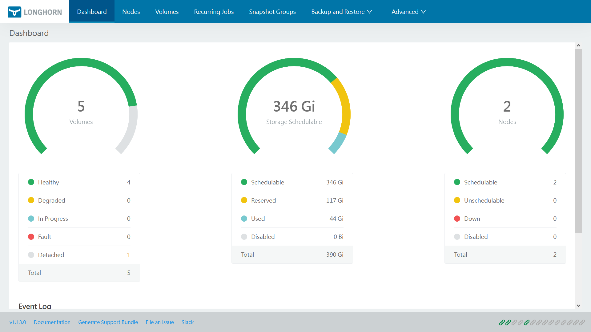
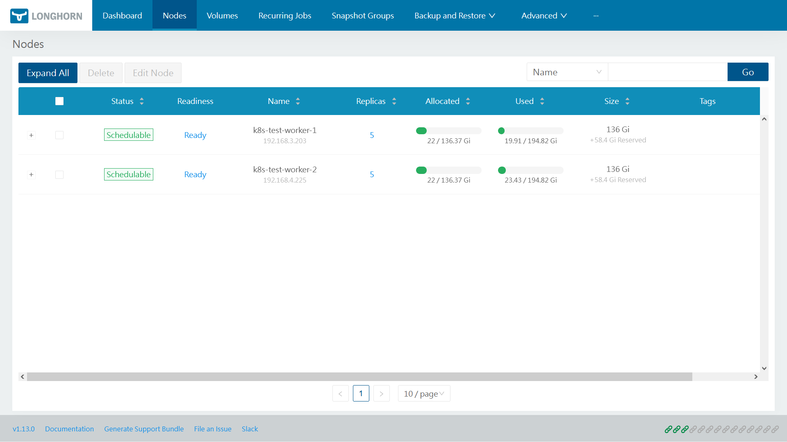
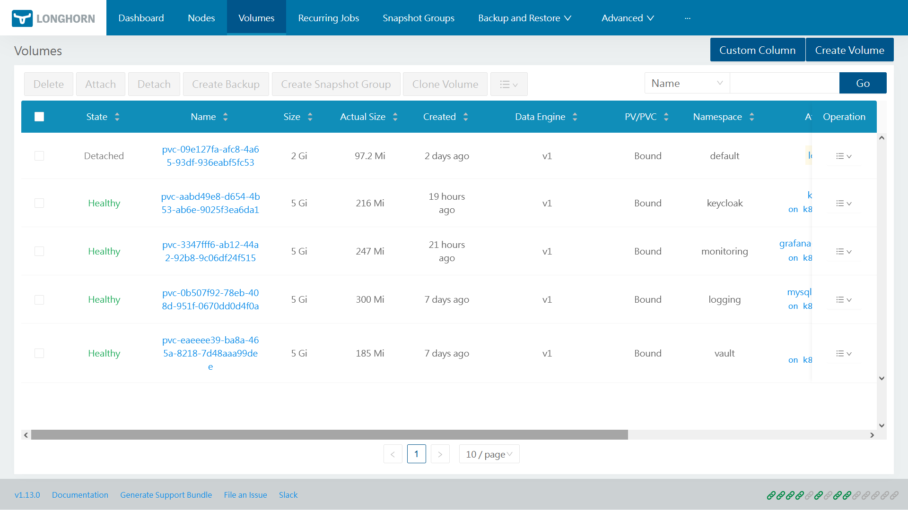
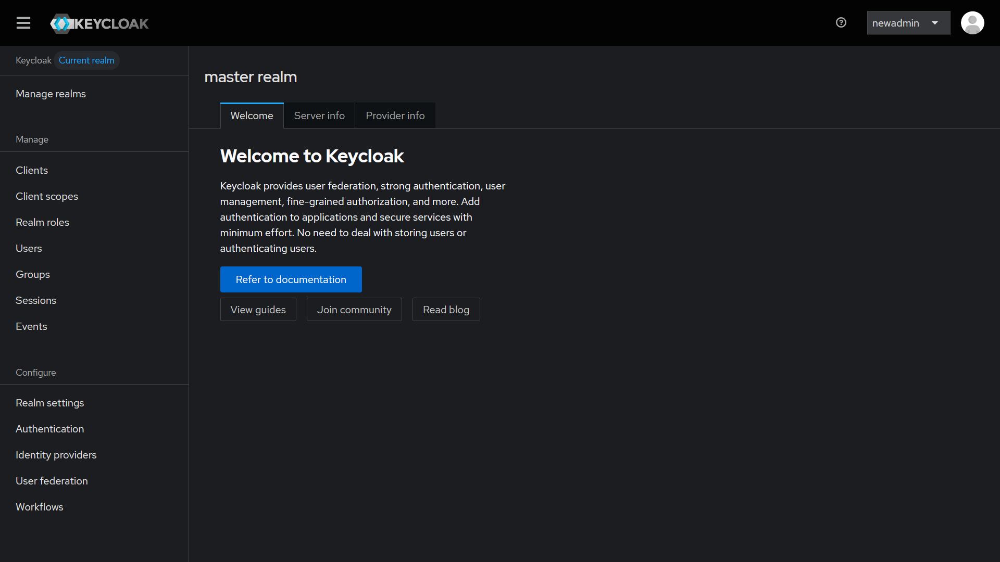

**Cập nhật triển khai trong cluster**

**Triển khai Longhorn**

Do cluster chưa có giải pháp persistent volume để các pod có thể lưu trữ dữ liệu trong thời gian dài => cần cài đặt. NFS (network file system) là lựa chọn đơn giản nhưng thiếu khả năng HA, storage overhead thấp, ko phù hợp cho những nhu cầu cần scale nên cần tìm những lựa chọn khác như Longhorn hay Rook Ceph.

Longhorn là một hệ thống distributed block service cho Kubernetes, hỗ trợ replication dữ liệu giữa các node. Khi một volume được cấu hình với số replica phù hợp, dữ liệu sẽ được duy trì trên nhiều node, tăng khả năng chịu lỗi khi 1 node gặp sự cố. Mỗi volume có pod controller và replica riêng. Một số đặc điểm:

- Thiết kế đặc biệt cho Kubernertes.
- Cài đặt đơn giản.
- Có UI frontend dễ quản lý.
- Hỗ trợ backup ra S3, NFS, CIFS.
- Phù hợp cho các cluster cỡ nhỏ tới vừa (5-20 node)

Rook Ceph: Rook là operator giúp Kubernetes quản lý và vận hàng cluster Ceph. Ceph có thể cung cấp block storage (RBD), file system (CephFS), object storage tương thích với S3 (RGW). Rook Ceph phù hợp cho các cluster lớn nhiều node, lượng storage cần quản lý lên tới petabyte, hiệu năng và độ tin cậy tốt nhưng triển khai phức tạp, yêu cầu nhiều tài nguyên hơn.

=> Longhorn phù hợp cho cluster này.

Thực hiện cài đặt Longhorn: có thể cài đặt qua nhiều cách như kubectl hay helm, argocd nhưng để đơn giản, thực hiện cài đặt bằng kubectl:

```
kubectl apply -f https://raw.githubusercontent.com/longhorn/longhorn/v1.13.0/deploy/longhorn.yaml
```

deployment sẽ tạo nhiều pod khác nhau, nên thực hiện kiểm tra sau khi cài đặt:

```
$ kubectl -n longhorn-system get pod
NAME                                                READY   STATUS    RESTARTS   AGE
longhorn-ui-b7c844b49-w25g5                         1/1     Running   0          2m41s
longhorn-manager-pzgsp                              1/1     Running   0          2m41s
longhorn-global-manager-5b7c9d8f4-2xk9p             1/1     Running   0          2m41s
longhorn-global-manager-5b7c9d8f4-8mq4z             1/1     Running   0          2m41s
longhorn-global-manager-5b7c9d8f4-t7wvn             1/1     Running   0          2m41s
longhorn-driver-deployer-6bd59c9f76-lqczw           1/1     Running   0          2m41s
longhorn-csi-plugin-mbwqz                           2/2     Running   0          100s
csi-snapshotter-588457fcdf-22bqp                    1/1     Running   0          100s
csi-snapshotter-588457fcdf-2wd6g                    1/1     Running   0          100s
csi-provisioner-869bdc4b79-mzrwf                    1/1     Running   0          101s
csi-provisioner-869bdc4b79-klgfm                    1/1     Running   0          101s
csi-resizer-6d8cf5f99f-fd2ck                        1/1     Running   0          101s
csi-provisioner-869bdc4b79-j46rx                    1/1     Running   0          101s
csi-snapshotter-588457fcdf-bvjdt                    1/1     Running   0          100s
csi-resizer-6d8cf5f99f-68cw7                        1/1     Running   0          101s
csi-attacher-7bf4b7f996-df8v6                       1/1     Running   0          101s
csi-attacher-7bf4b7f996-g9cwc                       1/1     Running   0          101s
csi-attacher-7bf4b7f996-8l9sw                       1/1     Running   0          101s
csi-resizer-6d8cf5f99f-smdjw                        1/1     Running   0          101s
instance-manager-b34d5db1fe1e2d52bcfb308be3166cfc   1/1     Running   0          114s
engine-image-ei-df38d2e5-cv6nc                      1/1     Running   0          114s
```

Nếu cài đặt thành công thì Longhorn đã có thể sử dụng được cơ bản, các pod cần PVC có thể call Longhorn để lưu data nhưng nếu cần config và quản lý các volume và node. Do cluster đã có setup gateway api thông qua traefik gatewayclass, có thể sử dụng httproute để expose UI ra ngoài. Đầu tiên nên tạo một auth secret cơ bản cho Longhorn:

```
USER=<USERNAME_HERE>; PASSWORD=<PASSWORD_HERE>; echo "${USER}:$(openssl passwd -stdin -apr1 <<< ${PASSWORD})" > auth
```

và tạo secret:

```
kubectl -n longhorn-system create secret generic basic-auth --from-file=auth
```

Traefik sử dụng Middlewares để handle authen và request limit. Tạo file middleware [longhorn-middlewares.yml](longhorn/longhorn-middlewares.yml) và apply. Sau đó tạo manifest httproute, nhớ connect với các middleware được tạo lúc trước: [longhorn-httproute.yml](longhorn/longhorn-httproute.yml)

- Sử dụng domain logging-test.vtcgame.vn đã được mở ra public.
- Chạy ở path /longhorn, trong httproute có thực hiện urlrewrite về / do các api của Longhorn chạy default ở path / trong pod.

Thực hiện apply và access dashboard ở /longhorn/:



- Theo dõi tổng dung lượng của cluster, dung lượng schedulable, reserved, used, disabled.
- Số lượng volume, node, trạng thái...



- Trạng thái các node, số lượng replica, lượng storage đã sử dụng và còn lại của các node.
- Sử dụng 2 node worker.



- Trạng thái của các volume, size được reserve cho các volume và size thực tế, data engine đang sử dụng, namespace và pod gắn liền với volume đó.
- Có thể schedule job cho các volume, edit volume, thêm hay delete.

Ngoài ra có thể:

- Tạo và quản lý snapshot của volume, xem snapshot chain.
- Backup và restore ra storage ngoài cluster như NFS, S3...
- Tạo các job định kỳ thực hiện những công việc như snapshot, backup, trim filesystem...

** Triển khai Vault**

Giờ đã có PVC, có thể cài đặt Vault. Thực hiện cài đặt qua helm như thường:

```
helm repo add hashicorp https://helm.releases.hashicorp.com
helm repo update
helm search repo hashicorp/vault
kubectl create namespace vault
```

Tạo 1 file khởi tạo [vault-values](vault/vault-values.yaml) và thực hiện install:

```
helm install vault hashicorp/vault -n vault -f vault-values.yaml
```

Để tương tác với Vault qua CLI, cần exec vào trong pod của vault:

```
kubectl exec -it -n vault vault-0 -- sh
```

Sau khi cài đặt, Vault sẽ ở trạng thái khóa (sealed) và cần thực hiện mở khóa. Thực hiện khởi tạo Vault:

```
vault operator init
```

Vault sẽ trả 5 key unseal và 1 root token có format như sau:

```
Unseal Key 1: <unseal-key-1>
Unseal Key 2: <unseal-key-2>
Unseal Key 3: <unseal-key-3>
Unseal Key 4: <unseal-key-4>
Unseal Key 5: <unseal-key-5>

Initial Root Token: <root-token>
```

Để unseal, chạy lệnh unseal và nhập key unseal vào. Lặp lại 3 lần:

```
vault operator unseal
```

Cuối cùng, cần thực hiện login bằng root token trước khi có thể tương tác với cli của vault:

```
vault login
```

Để lưu các dữ liệu có format key-value, cần thực hiện bật KVv2 secret engine của Vault:

```
vault secrets enable -path=secret kv-v2
```

Có nhiều cách để nhập secret vào vault:

- Thực hiện put trực tiếp: cách đơn giản nhất nhưng thiếu an toàn do có thể bị lộ secret qua lịch sử command.

```
vault kv put secret/logging/logging-be \
  spring.datasource.username='root' \
  spring.datasource.password='root'
```

- Nhập từ file json: phù hợp khi có nhiều key, an toàn hơn so với put trực tiếp.

```
{
  "spring.datasource.username": "root",
  "spring.datasource.password": "root"
}
```

```
vault kv put secret/logging/logging-be @secret.json
```

- Dùng API:

```
curl \
  --request POST \
  --header "X-Vault-Token: $VAULT_TOKEN" \
  --data '{
    "data": {
        "spring.datasource.username": "root",
        "spring.datasource.password": "root"
    }
  }' \
  http://127.0.0.1:8200/v1/secret/logging/logging-be
```

Kiểm tra secret:

```
vault kv get secret/logging/logging-be
```

(Chưa mở được UI)

**Triển khai Grafana**

Thực hiện triển khai Grafana trong cluster này. Có thể deploy qua kubectl thông thường hoặc qua helm nhưng deploy thông thường sẽ đơn giản hơn:

```
kubectl create namespace monitoring
```

Tạo file khởi tạo grafana.yaml. File sẽ chứa đầy đủ các object như persistent volume claim, deployment và service:

- Khởi tạo tài khoản admin gốc.
- Định nghĩa domain, root URL để có thể chạy grafana ở các path URL khác ngoài /

Để access được frontend, cần expose grafana sử dụng httproute của gateway api: [grafana-httproute.yaml](grafana/grafana-httproute.yaml)

- Ko cần thực hiện URL rewrite do đã set URL path của grafana từ trước.

Thực hiện apply các file manifest và access URL để vào dashboard Grafana.

**Triển khai Keycloak**

Muốn triển khai một giải pháp SSO cho các ứng dụng hỗ trợ authentication bằng OIDC => triển khai Keycloak.

Trước tiên cần setup DB cho Keycloak. PostgreSQL là DB được Keycloak hỗ trợ nhiều nhất và là lựa chọn chính thức cho Keycloak. Thực hiện tạo file manifest [keycloak-db.yaml](keycloak/keycloak-db.yaml)

- Add username, password authen DB vào trong secret.
- Reserve 5GB tạm thời cho DB
- Chạy ở port 5432 trong cluster.

Thực hiện apply, rồi setup file manifest cho Keycloak. [keycloak.yaml](keycloak/keycloak.yaml)

- Khởi tạo tài khoản bootstrap để có thể đăng nhập lần đầu.
- Connect với DB, đặt hostname.
- Chạy port 8080 trong cluster.

Thực hiện apply cả 2 file manifest, nếu thành công sẽ có 2 pod chạy trong namespace. Để expose Keycloak ra ngoài để user có thể tương tác: sử dụng gateway api httproute [keycloak-httproute.yaml](keycloak/keycloak-httproute.yaml).



**Thực hiện implement OIDC OSS cho Grafana**

Do Grafana hỗ trợ OIDC native, có thể implement Keycloak dễ dàng. Trong Keycloak thực hiện tạo realm và client mới như thường. Sau khi tạo thành công, copy secret key và lưu vào cluster dưới dạng secret [grafana-keycloak.yaml](keycloak/grafana-keycloak.yaml).

Để configure OIDC cho Grafana có thể làm qua UI nhưng để tiện lợi nhất, nên để các setting value trong file khởi tạo Grafana:

[grafana-addon.yaml](keycloak/grafana-addon.yaml)

