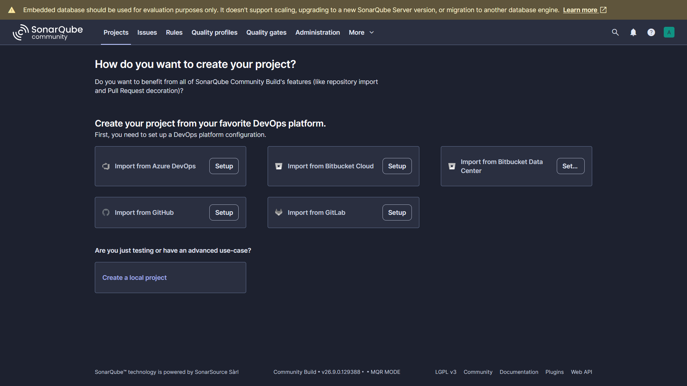
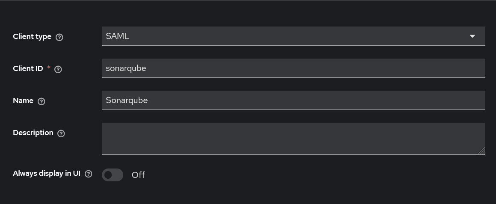
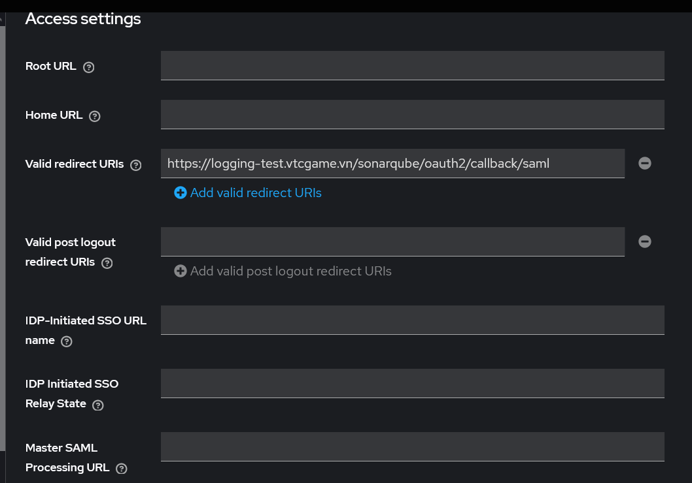
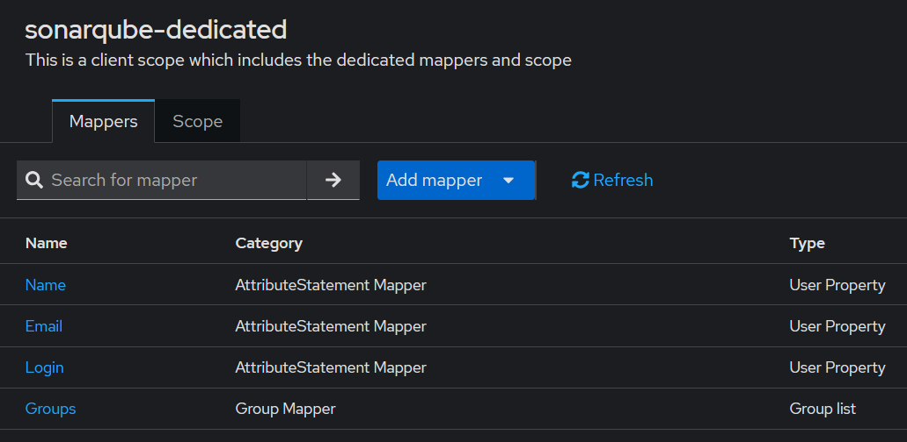
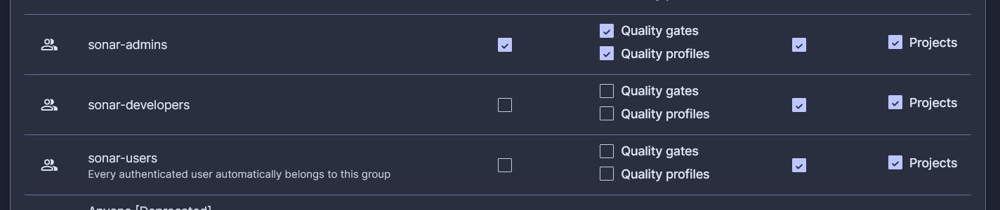
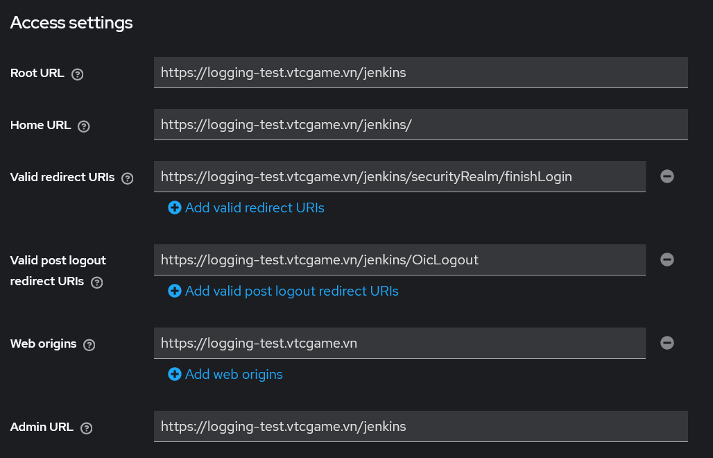
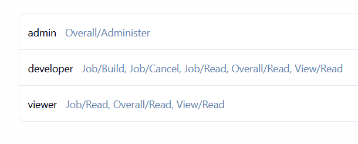
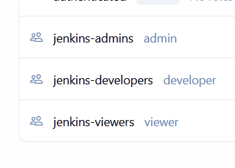

**Tiếp tục thực hiện setup các tool CI/CD và thiết lập Keycloak SSO cho chúng**

**Trivy**

Thực hiện triển khai Trivy qua Helm chart chính thức:

```
helm repo add aqua https://aquasecurity.github.io/helm-charts/
helm repo update
helm search repo aqua/trivy-operator
kubectl create namespace trivy
```

Cài đặt Trivy sử dụng các setting sau: [values.yaml](trivy/values.yaml)
```
helm install trivy-operator aqua/trivy-operator -n trivy -f values.yaml
```

- ignoreUnfixed: true cho phép trivy bỏ qua các lỗ hổng bảo mật chưa có fix.
- tolerations: - operator: "Exists" effect: "NoSchedule" cho phép các pod thực hiện công việc scan của Trivy và các node collector (thành phần thu thập thông tin liên quan đến node và workload trên node để phục vụ quá trình đánh giá bảo mật) chạy trên các node có taint NoSchedule (node HA và các node master)

Sau khi cài đặt thành công, trong namespace của trivy sẽ có 1 pod trivy-operator, cùng với nhiều pod scan khác được tạo và chạy lần lượt. Các pod này thực hiện scan các service khác trong toàn bộ namespace của cluster, và tự động xóa sau khi scan hoàn thành. Xem các báo cáo lỗ hổng:

```
kubectl get vulnerabilityreports -A
kubectl get vulnerabilityreports -A -o wide # Xem chi tiết
kubectl describe vulnerabilityreport -n <namespace> <report_name> # Xem cụ thể một báo cáo của 1 service
```

Ngoài ra có thể xem báo cáo scan config trong kubernetes:

```
kubectl get configauditreports -A
kubectl describe configauditreport -n <namespace> <report_name>
```

Các loại báo cáo khác của Trivy: exposedsecretreports (báo cáo các secret trong Kubernetes), rbacassessmentreports (báo cáo config role-based access control trong Kubernetes)...

Trivy thuần là một tool CLI chạy trong cluster nên ko có khả năng configure authentication/authorization, ko cần implement Keycloak.

**Sonarqube**

Thực hiện cài đặt Sonarqube:

```
kubectl create namespace sonarqube
helm repo add sonarqube https://SonarSource.github.io/helm-chart-sonarqube
helm repo update
```

Cần thực hiện cài đặt Sonarqube với cấu hình custom do yêu cầu resource default của Sonarqube khá lớn: [values.yaml](sonarqube/values.yaml)

- sonarWebContext: /sonarqube để set path web context mới cho Sonarqube.
- Tại phiên bản hiện tại của Sonarqube, yêu cầu phải có monitoringPasscode khi thực hiện khởi tạo. monitoringPasscode là 1 đoạn token dùng để authen request tới các endpoint monitoring và metrics nội bộ của Sonarqube mà ko cần full credentials của admin. Để thêm vào, có thể tạo 1 đoạn secret Kubernetes: [sonarqube-monitoring-secret.yaml](sonarqube/sonarqube-monitoring-secret.yaml) rồi thêm monitoringPasscodeSecretName và monitoringPasscodeSecretKey vào trong file values.yaml.

Cài đặt:

```
helm upgrade --install sonarqube sonarqube/sonarqube -n sonarqube -f values.yaml
```
Expose Sonarqube ra domain nội bộ sử dụng httproute của gateway api [sonarqube-httproute.yaml](sonarqube/sonarqube-httproute.yaml)

Access UI Sonarqube thành công.



Sonarqube hỗ trợ tích hợp Keycloak thông qua giao thức SAML 2.0 chứ ko sử dụng OIDC trực tiếp nhưng về chức năng thì vẫn đảm bảo, có thể đồng bộ Keycloak groups với Sonarqube groups để thực hiện phân quyền. Thực hiện tạo client type SAML



Callback URL SAML của Sonarqube nằm ở <>/oauth2/callback/saml, sử dụng làm valid redirect URi:



Để thực hiện phân quyền và liên kết groups giữa Keycloak và Sonarqube, thực hiện tạo các groups (VD như sonar-admins, sonar-developers, sonar-viewers) và gán các user test vào các group này.
 
Để SonarQube đọc được thông tin người dùng và Groups từ SAML Assertion, cần thực hiện cấu hình SAML mapper ở Keycloak. Tại mục client-scope, vào sonarqube-dedicated và thực hiện add mapper. Cần tạo 4 mapper như sau:

- Mapper type: User Property, Name: Name, Property: username, SAML attribute name: name.
- Mapper type: User Property, Name: Email, Property: email, SAML attribute name: email.
- Mapper type: User Property, Name: Login, Property: username, SAML attribute name: login.
- Mapper type: Group List, Name: Groups, Group attribute name: groups, Single Group Attribute: on, Full group path:	off.



Cần lấy các thông tin SAML từ Keycloak. Tại Realm settings -> General -> SAML 2.0 Identity Provider Metadata, lấy địa chỉ URL EntityDescriptor (provider ID), SingleSignonService (SAML login URL) và copy IdP certificate ở Realm settings -> Keys -> RS256 -> Certificate. Tại Sonarqube, vào Administration -> Configuration -> Authentication -> SAML, thực hiện nhập config:

- Application ID: sonarqube
- Provider Name: Keycloak
- Provider ID: Entity ID lấy từ metadata
- SAML login URL: SingleSignOnService Location
- Identity provider certificate: Certificate từ Keycloak
- SAML user login attribute: login
- SAML user name attribute:	name
- SAML user email attribute: email
- SAML group attribute:	groups

Trong General Settings -> General, đặt giá trị server base URL là https://logging-test.vtcgame.vn/sonarqube. Thực hiện lưu settings và thực hiện test configuration để kiểm tra kết quả SAML.

Trước khi bật Group synchronization, cần tạo các group có tên giống hệt group trong Keycloak. Để tạo group: Administration -> Security -> Users ->Groups. Lưu ý, để có thể match các group trong Keycloak với các group trong Sonarqube thì tên các groups phải giống nhau. Để phân quyền cho các group này, thực hiện set ở Administration -> Security -> Global Permissions.



Sau khi setup thành công, thực hiện đăng nhập bằng các tài khoản test.

**Jenkins**

Cách cài đặt Jenkins vào cluster Kubernetes đơn giản nhất là sử dụng Helm. Thực hiện add repo:

```
kubectl create namespace jenkins
helm repo add jenkins https://charts.jenkins.io
helm repo update
```

Cấu hình file values.yaml cho chart helm: [values.yaml](jenkins/values.yaml)

- jenkinsUriPrefix: set path URL cho Jenkins /jenkins, cần set để đảm bảo các API của Jenkins hoạt động chuẩn
- Giới hạn tài nguyên cho Jenkins
- Thực hiện cài sẵn một số plugin, hiện tại chưa cài đặt các plugin dùng để integrate Keycloak OIDC.
- Cấu hình tài khoản admin ban đầu.

Expose Jenkins ra domain nội bộ sử dụng httproute của gateway api: [jenkins-httproute.yaml](jenkins/jenkins-httproute.yaml)

Thực hiện apply cả 2 file và thực hiện access UI ở path đã định. Đăng nhập bằng tên username và password default là admin, password lấy bằng cách chạy:

```
kubectl exec --namespace jenkins -it svc/jenkins -c jenkins -- /bin/cat /run/secrets/additional/chart-admin-password && echo
```

Tại mục settings của Jenkins thì có thể thấy Jenkis báo reverse proxy set up is broken. Để khắc phục, vào mục System và thay đổi địa chỉ Jenkins URL sang địa chỉ domain thực của nó (https://logging-test.vtcgame.vn/jenkins/)

Để tích hợp Keycloak, thực hiện tạo một client OIDC trong Keycloak như thường lệ, client authen ON, standard flow ON. Access settings để phục vụ cho Jenkins sẽ như sau:



- Địa chỉ callback URL OIDC của Jenkins nằm ở /securityRealm/finishLogin
- Địa chỉ logout URL OIDC của Jenkins nằm ở /OicLogout.

Tại Jenkins, thực hiện cài đặt 2 plugin. Vào Manage Jenkins -> Plugins và cài đặt OpenID Connect Authentication và Role-based Authorization Strategy.

- OpenID Connect Authentication để có thể tích hợp các OIDC provider vào Jenkins, bao gồm Keycloak.
- Role-based Authorization Strategy để có thể phân quyền người dùng theo role, sử dụng các groups trong Keycloak.

Sau khi cài đặt và restart Jenkins, thực hiện config OIDC cho Jenkins tại Manage Jenkins -> Security -> Authentication -> Security Realm, chọn Login with OpenID Connect.

- Client id: client id đã đặt trong Keycloak.
- Client secret: lấy client secret key tại client trong Keycloak.
- Configure mode: sử dụng discovery via well-known endpoint. Sử dụng OIDC discovery endpoint của dịch vụ OIDC để configure các endpoint còn lại. Đối với keycloak, có thể lấy endpoint ở Realm Settings -> OpenID Endpoint Configuration. (/keycloak/realms/logging/.well-known/openid-configuration).
- Override scope: openid profile email
- User Name Field: preferred_username
- Full Name Field: name
- Email Field: email
- Groups Field: groups

Thực hiện lưu settings. Giờ có thể thực hiện login vào Jenkins bằng các tài khoản keycloak.

Để configure phân quyền, vào mục Role Management trong settings -> Manage Roles -> Add Role. Thực hiện đặt tên role và chọn các permission:



Sau đó thực hiện add các group và map các group này với role cần thiết. Các group mới phải có tên giống với group trong Keycloak:



Sau khi set xong các role và groups, save và thực hiện login bằng các tài khoản keycloak. Profile user và role, group sẽ được nhận khi login lần đầu.
Note: sau khi config role và group, Jenkins có thể cảnh báo:

```
The Restrict project naming configuration is not set to the Role-based Strategy. This can lead to problems as it allows users to create items, for which they have not the sufficient permissions to discover, read or configure.
```

Cảnh báo xuất hiện do Jenkins trước đang sử dụng project-based matrix authorization strategy hoặc một authorization strategy khác, nhưng mục restrict project naming chưa được cấu hình thành role-based strategy. Để thay đổi, vào mục Systems trong setting và chuyển phần Restrict project naming sang role-based strategy.

**Headlamp**

Headlamp được cài đặt qua Helm:

```
kubectl create namespace headlamp
helm repo add headlamp https://kubernetes-sigs.github.io/headlamp/
helm repo update
```

Cài đặt Headlamp sử dụng values.yaml sau: [values.yaml](headlamp/values.yaml)

- Thực hiện set path URL gốc và plugins cho Headlamp để nó có thể chạy ở 1 path riêng trong domain.

```
helm install headlamp headlamp/headlamp -n headlamp -f values.yaml
```

Thực hiện expose ra domain nội bộ: [headlamps-httproute.yaml](headlamp/headlamps-httproute.yaml)

Headlamp không có hệ thống username password riêng mà dựa vào kubernetes authentication và RBAC. Cách đơn giản nhất để thực hiện authen vào Headlamp là sử dụng ServiceAccount token. Để có 1 account để thực hiện login ban đầu, tạo service account: [service-account.yaml](headlamp/service-account.yaml) và clusterrolebinding [cluster-rbac.yaml](headlamp/cluster-rbac.yaml).

Thực hiện apply các file manifest. Để đăng nhập vào Headlamp, cần lấy token để đăng nhập:

```
kubectl create token headlamp-admin -n headlamp
```