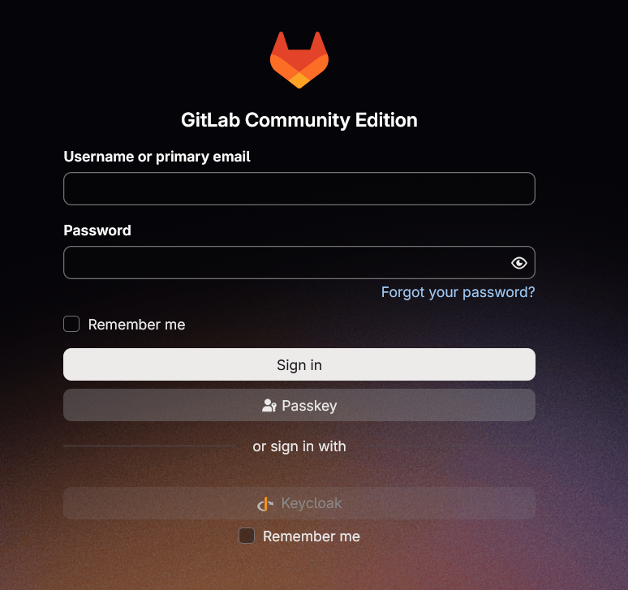

**Tiếp tục thực hiện setup các tool CI/CD và thiết lập Keycloak SSO cho chúng**

**Tóm tắt**
- Thực hiện setup Gitlab trong cluster và triển khai Keycloak OIDC cho nó.
- Viết chương trình backend sử dụng NodeJS (ExpressJS) để test khả năng tích hợp authentication sử dụng Keycloak OIDC cho các hệ thống chạy NodeJS.

**Gitlab**

Thực hiện triển khai Gitlab theo mô hình Omnibus, sử dụng phiên bản GitLab CE open source. Thực hiện configure storage, statefulset và service manifest để deploy Gitlab: [gitlab.yaml](gitlab/gitlab.yaml)

- configure các port ssh và http trong container
- xác định configmap và client secret key cho gitlab
- mount các volume data, config
- configure service.

Để có thể thực hiện config OIDC cho Gitlab về sau, nên đặt config cho Gitlab vào 1 file configmap riêng thay vì để chung với file manifest chính: [gitlab-config.yaml](gitlab/gitlab-config.yaml)

- xác định external URL của gitlab các API của gitlab chạy ở đúng path.
- Phần omnipath là của setting OIDC sẽ giải thích sau.

Expose gitlab ra domain nội bộ: [gitlab-httproute.yaml](gitlab/gitlab-httproute.yaml). Thực hiện apply các file và access gitlab ở path đã định. Note: gitlab cần khoảng 1 đên 5 phút để chuẩn bị trước khi sẵn sàng, trước đó nếu access gitlab thì sẽ bị 502 gateway error.

Đăng nhập lần đầu: tài khoản admin default của gitlab là root, password có thể lấy trong container như sau:

```
kubectl exec -n gitlab gitlab-0 -- cat /etc/gitlab/initial_root_password
```

Thực hiện đăng nhập và verify Gitlab đã hoạt động.

Để tích hợp Keycloak OIDC, trước tiên cần tạo client riêng cho gitlab tương tự như các ứng dụng trước:

- client type: openid connect
- client id: gitlab
- client authentication: on
- standard flow: on

OIDC call back url của gitlab là /users/auth/openid_connect/callback, trang đăng nhập của Gitlab ở /users/sign_in. Nên để post logout redirect uri là trang đăng nhập để khi người dùng logout thì khi thực hiện đăng nhập lại thì người dùng sẽ phải thực hiện nhập lại credentials.

Để lưu client secret thì có cách hiệu quả nhất là sử dụng đoạn command sau để có thể copy paste vào mà ko cần phải tạo file mới hay để bị lộ secret ra command line history:

```
read -rsp "Keycloak Client Secret: " OIDC_SECRET
echo

kubectl create secret generic gitlab-oidc -n gitlab --from-literal=GITLAB_OIDC_CLIENT_SECRET="$OIDC_SECRET" --dry-run=client -o yaml | kubectl apply -f -

unset OIDC_SECRET
```

Cuối cùng cần add setting OIDC vào config map của gitlab:

```
    gitlab_rails['omniauth_enabled'] = true

    gitlab_rails['omniauth_allow_single_sign_on'] = ['openid_connect']

    gitlab_rails['omniauth_block_auto_created_users'] = false

    gitlab_rails['omniauth_providers'] = [
      {
        name: 'openid_connect',
        label: 'Keycloak',
        args: {
          name: 'openid_connect',
          scope: ['openid', 'profile', 'email'],
          response_type: 'code',
          issuer: 'https://logging-test.vtcgame.vn/keycloak/realms/logging',
          discovery: true,

          client_auth_method: 'basic',
          uid_field: 'preferred_username',
          pkce: true,

          client_options: {
            identifier: 'gitlab',
            secret: ENV.fetch('GITLAB_OIDC_CLIENT_SECRET'),
            redirect_uri: 'https://logging-test.vtcgame.vn/gitlab/users/auth/openid_connect/callback'
          }
        }
      }
    ]
```

- enable sso, chọn method là openid connect
- chặn ko cho phép tạo tài khoản user mới ngoài tài khoản oidc (keycloak)
- thực hiện add setting provider: name, label, scope, địa chỉ issuer (realm và client), thực hiện fetch client secret từ secret kubernetes và set redirect uri.

Thực hiện apply lại config, rollout restart gitlab và thực hiện đăng nhập bằng keycloak.



Gitlab có hỗ trợ ánh xạ role/group của Keycloak tới role trong Gitlab nhưng chỉ có tier premium của bản enterprise mới hỗ trợ chức năng này.

**NodeJS (ExpressJS)**

Thực hiện tạo một ứng dụng backend sử dụng ExpressJS để tìm hiểu cách integrate Keycloak vào một ứng dụng tương tự. Backend đóng vai trò resource server và xác thực các token do Keycloak cung cấp, kiểm thử authen và authorization qua realm roles và client roles.

Link repo: https://github.com/RealTranaf/express-keycloak
Frontend sử dụng để thực hiện login và test các API: https://github.com/RealTranaf/keycloak-frontend

Backend sử dụng module jose để thực hiện xác thực các token của Keycloak. Nguyên tắc hoạt động:

- Nhận Access Token từ header Authorization.
- Kiểm tra token theo định dạng Bearer.
- Sử dụng createRemoteJWKSet() để lấy public keys từ Keycloak.
- Sử dụng jwtVerify() để xác thực chữ ký, issuer và thời hạn.
- Trích xuất thông tin người dùng và roles.
- Cho phép hoặc từ chối request dựa trên kết quả xác thực.

middleware sử dụng:

```
import { createRemoteJWKSet, jwtVerify } from 'jose'
import { env } from '../configs/env.js'

const issuer = env.keycloakIssuer
const clientId = env.keycloakClientId

const jwks = createRemoteJWKSet(
    new URL(`${issuer}/protocol/openid-connect/certs`)
)

// Verify Access Token
export async function authenticate(req, res, next) {
    try {
        const authHeader = req.headers.authorization

        if (!authHeader?.startsWith("Bearer ")) {
            return res.status(401).json({
                message: "Missing Bearer Token"
            })
        }

        const token = authHeader.substring(7)

        const { payload } = await jwtVerify(token, jwks, {
            issuer
        })

        // Extract roles
        const realmRoles = payload.realm_access?.roles || []

        const clientRoles =
            payload.resource_access?.[clientId]?.roles || []

        req.user = {
            id: payload.sub,
            username: payload.preferred_username,
            email: payload.email,
            name: payload.name,
            realmRoles,
            clientRoles
        }

        next()
    } catch (error) {
        console.error("Authentication failed:", error.message)

        return res.status(401).json({
            message: "Invalid or expired access token"
        })
    }
}
```

Tách biệt xác thực và phân quyền thành các middleware riêng:

```
// Check Realm Role
export function requireRealmRole (...roles) {
    return (req, res, next) => {
        const userRoles = req.user?.realmRoles || []

        const hasRole = roles.some(role =>
            userRoles.includes(role)
        )

        if (!hasRole) {
            return res.status(403).json({
                message: "Forbidden: Insufficient Realm Role"
            })
        }

        next()
    }
}

// Check Client Role
export function requireClientRole (...roles) {
    return (req, res, next) => {
        const userRoles = req.user?.clientRoles || []

        const hasRole = roles.some(role =>
            userRoles.includes(role)
        )

        if (!hasRole) {
            return res.status(403).json({
                message: "Forbidden: Insufficient Client Role"
            })
        }

        next()
    }
}
```

Các endpoint sử dụng để kiểm thử:

```
import { Router } from "express"

import { authenticate, requireRealmRole, requireClientRole } from "../middlewares/auth-middleware.js"

const router = Router()

// Public API
router.get("/public", (req, res) => {
    res.json({
        message: "This is a public API",
        authenticated: false
    })
})

// Authenticated API
router.get("/me", authenticate, (req, res) => {
    res.json({
        message: "Authentication successful",
        user: req.user
    })
})

// Realm Role: user
router.get("/user", authenticate, requireRealmRole("USER"), (req, res) => {
    res.json({
        message: "Welcome, user!",
        user: req.user
    })
})

// Realm Role: admin
router.get("/admin", authenticate, requireRealmRole("ADMIN"), (req, res) => {
    res.json({
        message: "Welcome, administrator!",
        user: req.user
    })
})

// Client Role: api-admin
router.get("/client-admin", authenticate, requireClientRole("api-admin"), (req, res) => {
    res.json({
        message: "Client role authorization successful",
        user: req.user
    })
})

export default router
```
- Có API public, kiểm tra người dùng đã login, kiểm tra realm role, client role...

Tuy nhiên để toàn hệ thống có thể sử dụng được Keycloak thì cũng cần phải thực hiện integrate keycloak ở frontend. Frontend sử dụng để test là ReactJS được triển khai qua Vite. Cần cài đặt module keycloak-js:

```
npm install keycloak-js
```
Frontend sử dụng Keycloak JS adapter để xử lý đăng nhập, đăng xuất, quản lý Access Token và Refresh Token. Thực hiện khởi tạo keycloak trong 1 file riêng:

```
import Keycloak from "keycloak-js"

const keycloak = new Keycloak({
    url: import.meta.env.VITE_KEYCLOAK_URL,
    realm: import.meta.env.VITE_KEYCLOAK_REALM,
    clientId: import.meta.env.VITE_KEYCLOAK_CLIENT_ID
})

export default keycloak
```

và khởi tạo adapter:

```
export async function initializeKeycloak() {
    return await keycloak.init({
        onLoad: "check-sso",
        pkceMethod: "S256",
        checkLoginIframe: false
    })
}
```

Các chức năng cần triển khai:
- login(): chuyển hướng người dùng đến Keycloak để đăng nhập.
- logout(): đăng xuất thông qua Keycloak.
- getAccessToken(): lấy access token hiện tại.
- getUserInfo(): lấy thông tin người dùng từ token.
- getRoles(): trích xuất realm roles và client roles.
- isAuthenticated(): kiểm tra trạng thái đăng nhập.

```
export async function login() {
    await keycloak.login({
        redirectUri: window.location.origin
    })
}

export async function logout() {
    await keycloak.logout({
        redirectUri: window.location.origin
    })
}

export function getUserInfo() {
    if (!keycloak.authenticated) {
        return null
    }

    return keycloak.tokenParsed
}

export function getRoles() {
    const token = getUserInfo()

    if (!token) {
        return {
            realmRoles: [],
            clientRoles: []
        }
    }

    const clientId = import.meta.env.VITE_KEYCLOAK_CLIENT_ID

    return {
        realmRoles: token.realm_access?.roles || [],
        clientRoles:
            token.resource_access?.[clientId]?.roles || []
    }
}

export function isAuthenticated() {
    return keycloak.authenticated
}
```

Access token có thời hạn sử dụng nên frontend cần chủ động kiểm tra và refresh token trước khi gọi API.

```
export async function getAccessToken() {
    if (!keycloak.authenticated) {
        throw new Error("User is not authenticated")
    }

    await keycloak.updateToken(30)

    return keycloak.token
}
```
- updateToken(30) yêu cầu keycloak-js kiểm tra token và refresh nếu thời gian còn lại nhỏ hơn 30s.

