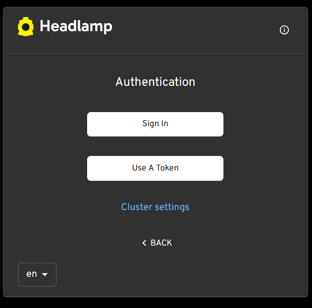
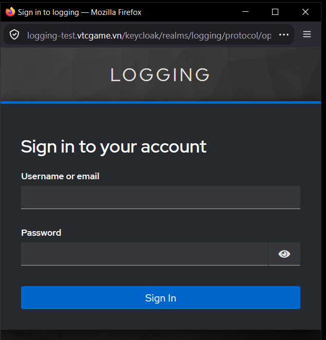
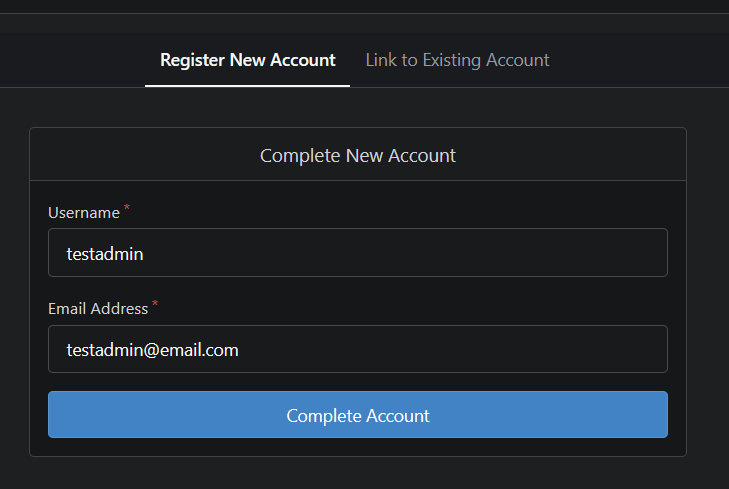
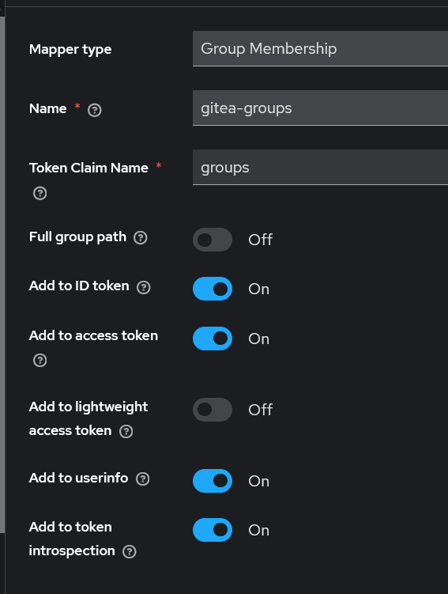
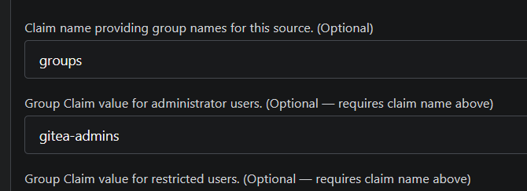

**Tóm tắt**

- Triển khai Keycloak OIDC cho Headlamp (chưa hoàn thành)
- Chuyển một số dữ liệu nhạy cảm của các ứng dụng đã triển khai từ Kubernetes secret sang Vault secret.
- Thực hiện triển khai Gitea và Keycloak OIDC SSO cho nó.
- Nghiên cứu giải pháp triển khai Keycloak OIDC SSO cho các ứng dụng mà ko cần phải can thiệp vào config của các ứng dụng thông qua sử dụng Oauth2 proxy middleware
- Nghiên cứu về VSO của Hashicorp Vault.

**Triển khai Keycloak OIDC cho Headlamp**

Thực hiện tạo client trong Keycloak như thường lệ:

- Client id: headlamp
- Client type: OpenID connect
- Client authentication: On
- Standard flow: On
- Valid redirect URI: https://logging-test.vtcgame.vn/headlamp/oidc-callback (địa chỉ OIDC callback của Headlamo nằm ở /oidc-callback)
- Web origin: https://logging-test.vtcgame.vn/headlamp

Cơ bản thì có thể đưa client key secret vào trong Kubernetes secret. Để ko bị lộ client key từ command history, nên add secret sử dụng read -s:

```
read -rsp "Enter Keycloak client secret: " CLIENT_SECRET
echo

kubectl create secret generic headlamp-oidc \
  -n headlamp \
  --from-literal=clientSecret="$CLIENT_SECRET" \
  --dry-run=client -o yaml | kubectl apply -f -

unset CLIENT_SECRET
```

Cập nhật lại file values.yaml để add config oidc:

```
config:
  inCluster: true
  inClusterContextName: main
  baseURL: /headlamp
  pluginsDir: /headlamp/plugins
  sessionTTL: 86400

  oidc:
    clientID: headlamp
    issuerURL: https://logging-test.vtcgame.vn/keycloak/realms/logging
    scopes: "openid profile email"
    autoLogin: false

    secret:
      create: false

    externalSecret:
      enabled: false

  extraArgs:
    - "-oidc-client-secret=$(OIDC_CLIENT_SECRET)"

env:
  - name: OIDC_CLIENT_SECRET
    valueFrom:
      secretKeyRef:
        name: headlamp-oidc
        key: clientSecret
```

- set client ID, URL cung cấp OIDC, scope.
- trỏ Headlamp tới sử dụng key lưu trong secret kubernetes

Thực hiện upgrade:

```
helm upgrade headlamp headlamp/headlamp \
  -n headlamp \
  -f values.yaml
```

Khi thành công, ở trang đăng nhập sẽ có option sign in:




**Chuyển các client key Keycloak cung cấp cho các ứng dụng từ Kube secret vào vault**

Kubernetes secret lưu tiện lợi nhưng thiếu bảo mật do secret chỉ được encode base64 đơn giản chứ ko sử dụng encryption thực thụ. Để chuyển đổi các client key sẵn có trong kube secret sang vault thì có thể chạy trực tiếp lệnh sau:

```
SECRET_VALUE=$(kubectl get secret <secret-name> \
  -n <namespace> \
  -o jsonpath='{.data.<secret-key>}' \
  | base64 -d)

kubectl exec -i -n vault vault-0 -- sh -c '
  read -r SECRET_VALUE
  vault kv put secret/<path> client_secret="$SECRET_VALUE"
  unset SECRET_VALUE
' <<< "$SECRET_VALUE"

unset SECRET_VALUE
```

- lấy value của một cặp key value trong secret thuộc 1 namespace và thực hiện put vào trong kv engine của vault.

VD: Đối với ứng dụng gitlab hiện tại, trước lưu client key ở secret gitlab-oidc, tên key là GITLAB_OIDC_CLIENT_SECRET, thuộc namespace gitlab:

```
SECRET_VALUE=$(kubectl get secret gitlab-oidc \
  -n gitlab \
  -o jsonpath='{.data.GITLAB_OIDC_CLIENT_SECRET}' \
  | base64 -d)

kubectl exec -i -n vault vault-0 -- sh -c '
  read -r SECRET_VALUE
  vault kv put secret/gitlab/oidc client_secret="$SECRET_VALUE"
  unset SECRET_VALUE
' <<< "$SECRET_VALUE"

unset SECRET_VALUE
```

Kiểm tra secret đã set thành công hay ko:

```
kubectl exec -n vault vault-0 -- \
  vault kv metadata get secret/gitlab/oidc
```

Sau đó, cần setup để ứng dụng có thể access được key trong vault. Cần tạo 1 vault policy cho ứng dụng, tạo 1 service account cho ứng dụng đó và tạo vault role gắn liền service account với policy. VD với gitlab, tạo policy:

```
path "secret/data/gitlab/oidc" {
  capabilities = ["read"]
}
```

và thực hiện apply vào vault:

```
kubectl cp gitlab-oidc-policy.hcl \
  vault/vault-0:/tmp/gitlab-oidc-policy.hcl

kubectl exec -n vault vault-0 -- \
  vault policy write gitlab-oidc /tmp/gitlab-oidc-policy.hcl
```

Sau đó tạo service account và vault role:

```
kubectl -n gitlab create serviceaccount gitlab-vault
```

```
kubectl exec -n vault vault-0 -- \
  vault write auth/kubernetes/role/gitlab \
  bound_service_account_names=gitlab-vault \
  bound_service_account_namespaces=gitlab \
  policies=gitlab-oidc \
  ttl=1h
```

- Như vậy, chỉ có ứng dụng sử dụng service account là gitlab-vault ở namespace gitlab mới có thể read được secret ở path secret/data/gitlab/oidc.

Cuối cùng, để vault có thể inject được secret vào ứng dụng, cần thêm vault agent injector vào manifest deployment hoặc statefulset. VD với gitlab, cần đưa vào spec.template.metadata.annotations:

```
apiVersion: apps/v1
kind: StatefulSet
metadata:
  name: gitlab
  namespace: gitlab
spec:
  template:
    metadata:
      annotations:
        vault.hashicorp.com/agent-inject: "true"

        vault.hashicorp.com/role: "gitlab"

        vault.hashicorp.com/agent-inject-secret-oidc: "secret/data/gitlab/oidc"

        vault.hashicorp.com/agent-inject-template-oidc: |
          {{- with secret "secret/data/gitlab/oidc" -}}
          {{ .Data.data.client_secret }}
          {{- end }}
    spec:
      serviceAccountName: gitlab-vault
```

Sau khi injector hoạt động, file secret sẽ được render vào /vault/secrets/oidc. Khi lấy secret sẽ thực hiện read file này. VD đối với gitlab, chỉnh sửa trong configmap:

```
secret: File.read('/vault/secrets/oidc').strip
```

Quá trình migrate secret đối với các ứng dụng khác cũng tương tự, chỉ khác ở cách thêm injector agent. Đối với jenkins setup bằng helm, add vào container.podAnnotations:

```
  podAnnotations:
    vault.hashicorp.com/agent-inject: "true"
    vault.hashicorp.com/role: "jenkins"
    vault.hashicorp.com/auth-path: "auth/kubernetes"
    vault.hashicorp.com/agent-inject-secret-oidc: "secret/data/jenkins/oidc"
    vault.hashicorp.com/agent-inject-template-oidc: |
      {{`{{- with secret "secret/data/jenkins/oidc" -}}`}}
      {{`{{ .Data.data.client_secret }}`}}
      {{`{{- end }}`}}
    vault.hashicorp.com/agent-inject-file-oidc: "oidc"
```

**Thực hiện triển khai Gitea và Keycloak OIDC SSO cho nó.**

Triển khai sử dụng Helm chart, file values.yaml được sử dụng: [values.yaml](gitea/values.yaml)

```
helm repo add gitea-charts https://dl.gitea.com/charts/
helm install gitea gitea-charts/gitea -f values.yaml
```

- file value setup storage, database postgresql, domain, root url, tài khoản admin gốc.

Httproute manifest sử dụng để mở ra domain nội bộ: [gitea-httproute.yaml](gitea/gitea-httproute.yaml)

Tích hợp Keycloak OIDC: thực hiện đăng nhập vào tài khoản admin default, vào Site Administration -> Identity & Access -> Authentication Sources. Thực hiện thêm authentication source mới:

- Authentication Type: OAuth2
- Authentication Name: keycloak
- OAuth2 Provider: OpenID Connect
- Client id: gitea (dùng client id đã đặt trong keycloak)
- Client secret: client secret lấy từ keycloak
- OpenID Connect Auto Discovery URL: https://logging-test.vtcgame.vn/keycloak/realms/logging/.well-known/openid-configuration
- Additional Scopes: openid profile email

Thực hiện add authentication source và logout để test đăng nhập Keycloak. Khi đăng nhập thành công, user có thể chọn tạo 1 tài khoản gitea mới hoặc liên kết với một tài khoản gitea cũ:



Configure role: trong Gitea có thể configure ánh xạ group trong keycloak với role administrator và restricted users trong gitea. Vào client trong keycloak -> client scope -> gitea-dedicated, thêm token mapper loại group membership.

 

Trong gitea, tại setting của authentication source vừa tạo, thêm claim name của groups:



Như vậy, các user thuộc group gitea-groups sẽ có quyền admin trong gitea.

**Giải pháp triển khai Keycloak OIDC SSO cho các ứng dụng mà ko cần phải can thiệp vào config của các ứng dụng thông qua sử dụng Oauth2 proxy middleware**

Do công ty có nhiều ứng dụng, có những ứng dụng ko thể bị gián đoạn nên việc config riêng cho từng ứng dụng có thể khó khăn. Một giải pháp vẫn có thể implement keycloak oidc sso cho các ứng dụng này mà ko cần phải can thiệp trực tiếp vào deployment hay statefulsets của ứng dụng là triển khai OAuth2 Proxy Middleware trên cluster và implement keycloak oidc sso ở đó.

OAuth2 Proxy được triển khai dưới dạng một dịch vụ dùng chung, kết nối với Keycloak thông qua giao thức oidc để thực hiện xác thực người dùng và quản lý phiên đăng nhập. Về cơ bản thì khi truy cập domain của ứng dụng, người dùng sẽ được redirect tới trang đăng nhập của Keycloak để thực hiện xác minh.

Phương pháp này sử dụng middleware nên ko can thiệp trực tiếp vào hoạt động của ứng dụng và có thể tái sử dụng cho các ứng dụng khác nhưng do ko can thiệp vào hệ thống auth của chính ứng dụng nên sẽ không thay thế hệ thống tài khoản của ứng dụng, người dùng vẫn sẽ phải đăng nhập vào ứng dụng như thường.

Thực hiện triển khai: tạo một client chung cho oauth2 proxy:

- client id: cluster-sso
- client type: OpenID Connect
- Authentication flow: standard flow
- Valid redirect URIs: https://logging-test.vtcgame.vn/oauth2/callback
- Web origin: https://logging-test.vtcgame.vn
- require PKCE: on, S256

Để triển khai oauth2 proxy trong cluster, cần có cả client secret lấy từ keycloak và cookie secret. Để generate cookie secret, chạy command sau:

```
openssl rand -base64 32 | tr -- '+/' '-_'
```

Thực hiện input các key vào kube secret:

```
read -rsp "Keycloak Client Secret: " CLIENT_SECRET
echo

read -rsp "Cookie Secret: " COOKIE_SECRET
echo

kubectl create secret generic oauth2-proxy-secret \
  -n oauth2-proxy \
  --from-literal=client-secret="$CLIENT_SECRET" \
  --from-literal=cookie-secret="$COOKIE_SECRET"

unset CLIENT_SECRET COOKIE_SECRET
```

Oauth2 proxy sẽ chạy dưới dạng một container trong cluster, manifest và deployment của nó: [oauth2-proxy.yaml](oauth2-proxy/oauth2-proxy.yaml)

- --provider=keycloak-oidc: sử dụng Keycloak làm identity provider
- --client-id=cluster-sso: client được đăng ký trên keycloak
- --oidc-issuer-url: địa chỉ realm trên keycloak
- --redirect-url: endpoint tiếp nhận callback sau khi người dùng đăng nhập thành công
- --scope=openid email profile: yêu cầu các thông tin định danh cơ bản của người dùng
- --code-challenge-method=S256: sử dụng PKCE để tăng cường bảo mật trong quá trình xác thực
- --reverse-proxy=true: cho phép OAuth2 proxy hoạt động phía sau reverse proxy.
- --upstream=static://202: trả về HTTP 202 khi xác thực thành công, không chuyển tiếp request đến ứng dụng cụ thể.
- --set-xauthrequest=true: Cho phép cung cấp thông tin xác thực thông qua các HTTP header như X-Auth-Request-User, X-Auth-Request-Email.
- Cấu hình cookie với tên _oauth2_proxy, domain logging-test.vtcgame.vn và path / để hỗ trợ chia sẻ trạng thái đăng nhập giữa các ứng dụng cùng domain.
- --cookie-secure=true: chỉ truyền cookie qua HTTPS.
- --cookie-samesite=lax: thiết lập chính sách SameSite nhằm hạn chế rủi ro CSRF.
- --cookie-expire=8h: thời gian tồn tại max của cookie là 8 giờ.
- --cookie-refresh=1h: Thực hiện refresh session sau 1h
- -- --whitelist-domain: giới hạn domain được phép sử dụng trong các redirect.
- Sử dụng Redis làm Session Store thông qua --session-store-type=redis.

Thực hiện apply:

```
kubectl apply -f oauth2-proxy.yaml
```

Cần expose proxy ra domain để các ứng dụng có thể thực hiện redirect tới proxy. [oauth2-proxy-httproute.yaml](oauth2-proxy/oauth2-proxy-httproute.yaml).

Sau đó, cần tạo middleware ForwardAuth cho từng ứng dụng, dùng endpoint / kết hợp upstream=static://202 để thực hiện xác thực và redirect trực tiếp. Ví dụ áp dụng cho jenkins:

```
apiVersion: traefik.io/v1alpha1
kind: Middleware
metadata:
  name: oauth2-proxy-forward-auth
  namespace: jenkins
spec:
  forwardAuth:
    address: http://oauth2-proxy.oauth2-proxy.svc.cluster.local:4180/
    trustForwardHeader: true
    authResponseHeaders:
      - X-Auth-Request-User
      - X-Auth-Request-Email
      - X-Auth-Request-Preferred-Username
```

Các ứng dụng khác có thể sử dụng lại middleware này, thay đối namespace. Thực hiện apply, rồi trong httproute manifest thực hiện add middleware vào spec.rules.filters:

```
      filters:
        - type: ExtensionRef
          extensionRef:
            group: traefik.io
            kind: Middleware
            name: oauth2-proxy-forward-auth
```

Thực hiện apply lại. Giờ khi truy cập ứng dụng trên web sẽ được yêu cầu login qua keycloak trước khi có thể truy cập. Session đăng nhập đó có thể được dùng lại cho các ứng dụng có sử dụng middleware proxy này hoặc tích hợp Keycloak.

SECRET_VALUE=$(kubectl get secret headlamp-oidc \
  -n headlamp \
  -o jsonpath='{.data.clientSecret}' \
  | base64 -d)

kubectl exec -i -n vault vault-0 -- sh -c '
  read -r SECRET_VALUE
  vault kv put secret/headlamp/oidc clientSecret="$SECRET_VALUE"
  unset SECRET_VALUE
' <<< "$SECRET_VALUE"

unset SECRET_VALUE

***Nghiên cứu về VSO của Hashicorp Vault.**

Vault Secrets Operator (VSO) là một Kubernetes operator cho phép tích hợp Vault với kubernetes nhằm quản lý và đồng bộ secrets từ Vault vào Kubernetes Secrets. VSO chịu trách nhiệm lấy dữ liệu từ Vault và đồng bộ xuống Kubernetes Secret tương ứng.

Một số chức năng chính của VSO:
- Tự động đồng bộ secrets từ Vault xuống Kubernetes Secrets.
- Hỗ trợ xác thực với Vault thông qua Kubernetes Authentication.
- Định kỳ kiểm tra và cập nhật secrets khi dữ liệu trên Vault thay đổi.
- Hỗ trợ tự động restart các workload khi secret được cập nhật, giúp ứng dụng nhận được thông tin xác thực mới.
- Tập trung quản lý secrets tại Vault, giảm việc lưu trữ và quản lý thủ công các thông tin nhạy cảm trong Kubernetes.

Thực hiện cài đặt VSO:

```
helm repo add hashicorp https://helm.releases.hashicorp.com
helm install vault-secrets-operator hashicorp/vault-secrets-operator --namespace vault-secrets-operator --create-namespace
```

Implement vào client key secret của Headlamp:

Thực hiện nhập client secret:

```
read -rsp "Enter Headlamp Client Secret: " CLIENT_SECRET
echo

kubectl exec -i -n vault vault-0 -- \
  sh -c 'vault kv put secret/headlamp/oidc clientSecret="$(cat)"' \
  <<< "$CLIENT_SECRET"

unset CLIENT_SECRET
```

Cấu hình vault policy riêng cho headlamp:

```
path "secret/data/headlamp/oidc" {
  capabilities = ["read"]
}
```

Policy này không cấp quyền ghi, xóa hoặc truy cập các secret khác trong Vault. Đăng ký policy:

```
vault policy write headlamp-oidc headlamp-policy.hcl
```

Sau đó tạo service account như thường:

```
kubectl create serviceaccount vso-headlamp -n headlamp

kubectl exec -n vault vault-0 -- \
  vault write auth/kubernetes/role/headlamp-vso \
  bound_service_account_names=vso-headlamp \
  bound_service_account_namespaces=headlamp \
  policies=headlamp-policy \
  ttl=1h
```

Khi VSO cần truy cập Vault, nó sử dụng danh tính service account để xác thực và nhận Vault Token với quyền được giới hạn bởi policy headlamp-oidc.

Trong VSO có 1 số tài nguyên cần khai báo:

- VaultConnection: địa chỉ kết nối đến Vault thông qua Kubernetes Service.
- VaultAuth: phương thức xác thực Kubernetes
- VaultStaticSecret: secret cần đồng bộ từ Vault

Thực hiện khai báo [headlamp-vso.yaml](vso/headlamp-vso.yaml)

- mount và path xác định vị trí lấy secret trong Vault.
- refreshAfter: kiểm tra dữ liệu 60s 1 lần
- destination.create: true cho phép VSO tự tạo Kubernetes Secret.
- hmacSecretData: true sử dụng HMAC để phát hiện thay đổi dữ liệu secret.
- rolloutRestartTargets khai báo Deployment cần restart khi secret được cập nhật.

Thực hiện apply, nếu đã config để ứng dụng lấy key từ kube secret từ trước thì sẽ ko cần thay đổi gì. Giờ đây, khi thay đổi client secret thì trong lần quét secret tiếp theo, cluster sẽ thực hiện restart ứng dụng.

