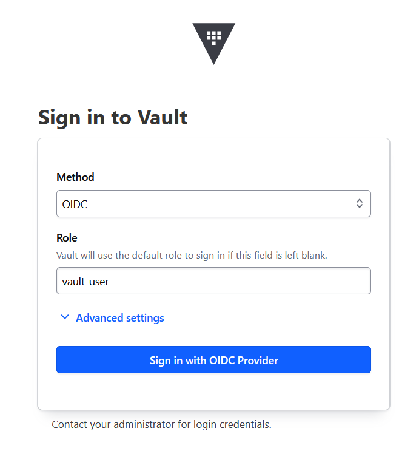
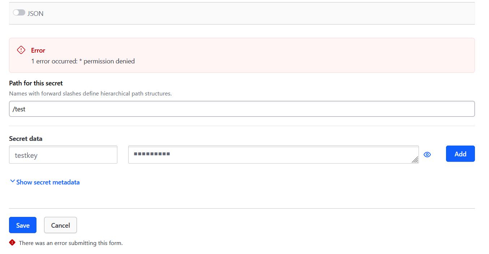

Tóm tắt:

- Implement Keycloak OIDC cho Vault.

**Implement Keycloak OIDC cho Vault**

Thực hiện tạo client trong Keycloak như thường lệ:

- Client type: OpenID Connect
- Client ID: vault
- Client authentication: ON
- Standard flow: ON
- Root URL: https://logging-test.vtcgame.vn
- Valid redirect URIs: https://logging-test.vtcgame.vn/ui/vault/auth/oidc/oidc/callback (địa chỉ OIDC callback URL của Vault nằm ở /ui/vault/auth/oidc/oidc/callback)
- Web origins: https://logging-test.vtcgame.vn

Tiếp đến, thực hiện access vault trong pod và đăng nhập bằng root token:

```
kubectl exec -it -n vault vault-0 -- sh
export VAULT_ADDR=http://127.0.0.1:8200
read -s VAULT_TOKEN
export VAULT_TOKEN
```

Kiểm tra các auth method đang có trong Vault, nếu chưa có /oidc thì thực hiện enable:

```
vault auth list
vault auth enable oidc
```

Cấu hình OIDC: nhập client secret lấy từ Keycloak và thiết lập cấu hình:

```
read -s OIDC_CLIENT_SECRET
vault write auth/oidc/config \
  oidc_discovery_url="https://logging-test.vtcgame.vn/keycloak/realms/logging" \
  oidc_client_id="vault" \
  oidc_client_secret="$OIDC_CLIENT_SECRET" \
  default_role="vault-user" \
  oidc_scopes="openid,profile,email"
unset OIDC_CLIENT_SECRET
```

- Sử dụng read -s để nhập client secret để ko bị lộ trong command history.
- oidc_discovery_url: endpoint để Vault lấy OIDC metadata từ Keycloak
- oidc_client_id: client ID đã tạo
- oidc_client_secret: client secret
- default_role: role mặc định khi đăng nhập Vault bằng OIDC
- oidc_scopes: các thông tin yêu cầu từ Keycloak

User đăng nhập vào Vault mặc định sẽ sử dụng role vault-user, vậy cần tạo role OIDC này:

```
vault write auth/oidc/role/vault-user \
  bound_audiences="vault" \
  allowed_redirect_uris="https://logging-test.vtcgame.vn/ui/vault/auth/oidc/oidc/callback" \
  allowed_redirect_uris="http://localhost:8250/oidc/callback" \
  user_claim="sub" \
  token_policies="default" \
  ttl="1h"
```

- bound_audiences: chỉ chấp nhận token dành cho client vault.
- allowed_redirect_uris: callback URL cho Vault UI và Vault CLI. Cần phải cấu hình ở cả Keycloak và Vault.
- user_claim: sử dụng sub làm định danh duy nhất của người dùng.
- token_policies: policy được gán cho Vault token sau đăng nhập
- ttl: thời hạn token là 1h.

Kiểm tra cấu hình:

```
vault read auth/oidc/config # Kiểm tra OIDC config
vault read auth/oidc/role/vault-user # Kiểm tra role
vault auth list # Kiểm tra auth method
```

Để đăng nhập, chọn method OIDC, nhập role là vault-user và thực hiện Sign in. Trình duyệt sẽ redirect sang Keycloak để người dùng đăng nhập. Người dùng đăng nhập thành công có policy default, thời hạn 1h.   



Để thực hiện phân quyền, có thể sử dụng ánh xạ keycloak groups tới vault identity groups, mỗi group có policy riêng làm cơ chế phân quyền. 

Dựng 3 group mẫu là vault-admins, vault-developers và vault-viewers. Trong keycloak, thực hiện tạo 3 group có tên như vậy, add các tài khoản user vào các group này và tạo group membership mapper. Vào Client -> vault -> Client scope -> vault-dedicated -> Configure a new mapper -> Group membership. Cấu hình:

- Name: vault-groups
- Token Claim Name: groups
- Full group path: off
- Add to ID token: on
- Add to access token: on
- Add to userinfo: on

Trong Vault, thực hiện exec vào pod và đăng nhập bằng root token như vừa thực hiện:

```
export VAULT_ADDR=http://127.0.0.1:8200
read -s VAULT_TOKEN
export VAULT_TOKEN
```

Thực hiện tạo các policy khác nhau cho các group khác nhau:

```
vault policy write vault-admin - <<'EOF'
path "secret/data/*" {
  capabilities = ["create", "read", "update", "delete"]
}

path "secret/metadata/*" {
  capabilities = ["create", "read", "update", "delete", "list"]
}
EOF
```

- Policy cho group vault-admins: có quyền CRUD ở engine KV2.

Làm tương tự cho 2 group còn lại:

```
vault policy write vault-developer - <<'EOF'
path "secret/data/*" {
  capabilities = ["create", "read", "update"]
}

path "secret/metadata/*" {
  capabilities = ["read", "list"]
}
EOF
```

```
vault policy write vault-viewer - <<'EOF'
path "secret/data/*" {
  capabilities = ["read"]
}

path "secret/metadata/*" {
  capabilities = ["read", "list"]
}
EOF
```

Để liên kết group từ keycloak với các policy này, cần tạo external group trong vault:

```
vault write identity/group \
  name="vault-admins" \
  type="external" \
  policies="vault-admin"

vault write identity/group \
  name="vault-developers" \
  type="external" \
  policies="vault-developer"

vault write identity/group \
  name="vault-viewers" \
  type="external" \
  policies="vault-viewer"
```

Vault cần mount_accessor để xác định group Alias thuộc Auth method nào. Chạy command sau và tìm value của accessor ở mục oidc:

```
vault auth list -format=json
```

Khi đã có được mount_accessor, cần tạo các group alias liên kết các keycloak group với vault external group:

```
GROUP_ID=$(vault read -field=id \
  identity/group/name/vault-admins)
vault write identity/group-alias \
  name="vault-admins" \
  mount_accessor="<accessor>" \
  canonical_id="$GROUP_ID"

GROUP_ID=$(vault read -field=id \
  identity/group/name/vault-developers)
vault write identity/group-alias \
  name="vault-developers" \
  mount_accessor="<accessor>" \
  canonical_id="$GROUP_ID"

GROUP_ID=$(vault read -field=id \
  identity/group/name/vault-viewers)
vault write identity/group-alias \
  name="vault-viewers" \
  mount_accessor="<accessor>" \
  canonical_id="$GROUP_ID"
```

Cấu hình OIDC hiện tại trong Vault chưa nhận group claim, cần add vào:

```
vault write auth/oidc/role/vault-user \
  groups_claim="groups"
```

Nếu cấu hình thành công, khi đăng nhập bằng tài khoản có group là user thì nếu muốn tạo secret thì sẽ bị Vault từ chối:

